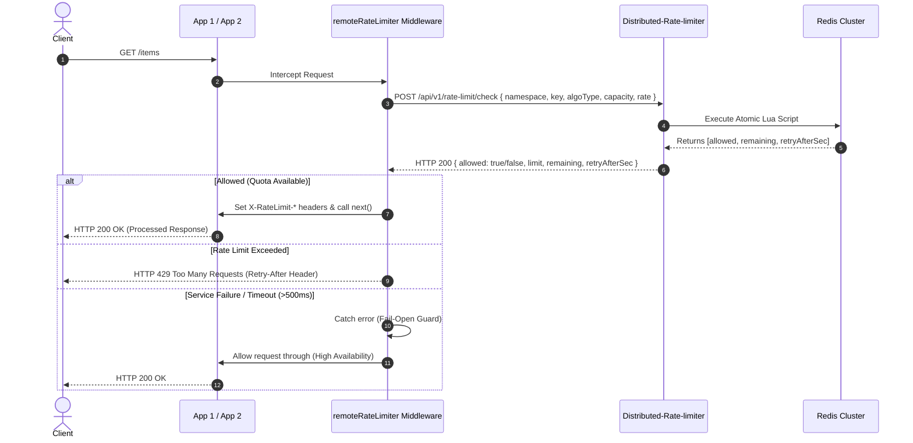

# Distributed Rate Limiting Platform

An enterprise-grade, distributed rate-limiting platform engineered with **Node.js**, **TypeScript**, **Express**, **Redis**, and **PostgreSQL (via Prisma 7)**. This repository implements a high-throughput, centralized rate-limiting tier consumed by independent client microservices (`app 1` and `app 2`) using an atomic, fail-open HTTP middleware pattern.

---

## Table of Contents

- [System Architecture](#system-architecture)
- [Repository Structure](#repository-structure)
- [Rate Limiting Algorithms](#rate-limiting-algorithms)
  - [1. Token Bucket](#1-token-bucket)
  - [2. Leaky Bucket](#2-leaky-bucket)
  - [3. Fixed Window Counter](#3-fixed-window-counter)
  - [4. Sliding Window Log](#4-sliding-window-log)
  - [Algorithm Trade-off Matrix](#algorithm-trade-off-matrix)
- [End-to-End Request Flow](#end-to-end-request-flow)
- [Services & Ports Reference](#services--ports-reference)
- [Quick Start Guide](#quick-start-guide)
  - [Prerequisites](#prerequisites)
  - [Running via Docker Compose](#running-via-docker-compose-recommended)
  - [Running Locally for Development](#running-locally-for-development)
- [Verification & Load Testing](#verification--load-testing)
- [Production & Resilience Engineering](#production--resilience-engineering)
- [License](#license)

---

## System Architecture

```
                                  ┌────────────────────────┐
                                  │   Ingress / Clients    │
                                  └───────────┬────────────┘
                                              │
                      ┌───────────────────────┴───────────────────────┐
                      │                                               │
               HTTP Requests                                   HTTP Requests
                      ▼                                               ▼
         ┌─────────────────────────┐                     ┌─────────────────────────┐
         │          App 1          │                     │          App 2          │
         │   Client Microservice   │                     │   Client Microservice   │
         │      (Port: 4000)       │                     │      (Port: 5000)       │
         └────────────┬────────────┘                     └────────────┬────────────┘
                      │                                               │
                      │ POST /api/v1/rate-limit/check                 │ POST /api/v1/rate-limit/check
                      │ (Atomic Check + Fail-Open)                    │ (Atomic Check + Fail-Open)
                      └───────────────────────┬───────────────────────┘
                                              │
                                              ▼
                             ┌─────────────────────────────────┐
                             │    Distributed-Rate-limiter     │
                             │      Core Limiting Engine       │
                             │          (Port: 3000)           │
                             └───────┬─────────────────┬───────┘
                                     │                 │
                           Redis Lua │                 │ Prisma ORM
                                     ▼                 ▼
                         ┌───────────────────┐  ┌─────────────────────┐
                         │   Redis Server    │  │  PostgreSQL (16)    │
                         │ Distributed State │  │ Application DB      │
                         │   (Port: 6380)    │  │ (Port: 5432)        │
                         └───────────────────┘  └─────────────────────┘
                                     ▲
                                     │ Scrapes Telemetry
                         ┌───────────┴───────┐
                         │    Prometheus     │
                         │    Monitoring     │
                         │   (Port: 9090)    │
                         └───────────────────┘
```

---

## Repository Structure

```
.
├── .gitignore                      # Enterprise monorepo gitignore
├── README.md                       # Master platform documentation (this file)
│
├── Distributed-Rate-limiter/       # Centralized rate-limiting & auth engine
│   ├── dockerfile                  # Multi-stage production container build
│   ├── docker-compose.yml          # Full stack orchestration (App + DB + Redis + Prometheus)
│   ├── prometheus.yml              # Prometheus scrape configuration
│   ├── prisma/                     # Database schema and migration logs
│   ├── src/
│   │   ├── config/                 # Redis, DB, logger, and server configs
│   │   ├── controllers/            # Rate limiter, auth, and metrics controllers
│   │   ├── metrics/                # Prometheus gauge and bucket collectors
│   │   ├── middlewares/            # Error handling and local rate limiting
│   │   ├── service/                # Core algorithms (Token, Leaky, Fixed, Sliding)
│   │   └── validators/             # Zod schema input validation
│   └── package.json
│
├── app 1/                          # Client service 1 (Port 4000)
│   ├── src/
│   │   ├── app.ts                  # Express application setup with rate-limited routes
│   │   ├── server.ts               # Process lifecycle and graceful shutdown
│   │   └── middlewares/
│   │       └── remoteRateLimiter.ts # High-availability client SDK middleware
│   └── package.json
│
└── app 2/                          # Client service 2 (Port 5000)
    ├── src/
    │   ├── app.ts                  # Express application setup with rate-limited routes
    │   ├── server.ts               # Process lifecycle and graceful shutdown
    │   └── middlewares/
    │       └── remoteRateLimiter.ts # High-availability client SDK middleware
    └── package.json
```

---

## Rate Limiting Algorithms

The core rate-limiting engine provides four distinct algorithms, allowing engineering teams to choose the ideal strategy based on endpoint sensitivity, burst allowance, and downstream system resilience:

### 1. Token Bucket
- **Mechanism:** Tokens are accumulated in a bucket up to `capacity` at a constant `refillRate` (tokens/second). Each request consumes one token.
- **State in Redis:** Stored as a Redis Hash (`ratelimit:token:<key>`) holding `{ tokens, last }`.
- **Best For:** General public REST APIs where clients are allowed occasional bursts of traffic (e.g. mobile apps loading a dashboard) without penalty.

### 2. Leaky Bucket
- **Mechanism:** Requests enter a bucket that drains continuously at a constant `leakRate` (requests/second). If incoming requests exceed bucket capacity, overflow is immediately rejected.
- **State in Redis:** Stored as a Redis Hash (`ratelimit:leaky:<key>`) holding `{ level, last }`.
- **Best For:** Protecting fragile downstream systems (e.g. third-party payment gateways, SMS providers) that require strictly smoothed traffic and cannot tolerate bursts.

### 3. Fixed Window Counter
- **Mechanism:** Divides time into fixed intervals (e.g. 60-second windows). Increments a simple integer counter per client. Auto-resets via Redis TTL.
- **State in Redis:** Stored as a Redis String counter (`ratelimit:fixed:<key>`) with an atomic `INCR` + `EXPIRE` Lua script.
- **Best For:** High-throughput, non-critical endpoints where memory efficiency is paramount and boundary bursts (up to $2\times$ quota at window edges) are acceptable.

### 4. Sliding Window Log
- **Mechanism:** Records exact microsecond timestamps of each request into a Redis Sorted Set (`ZSET`). Expired timestamps older than the rolling window are pruned before checking the quota.
- **State in Redis:** Stored as a Redis Sorted Set (`ratelimit:sliding:<key>`) scored by Unix epoch millisecond timestamps.
- **Best For:** High-security and critical business endpoints (e.g. `/auth/login`, credit card checkout) where boundary-straddling attacks must be strictly prevented.

---

### Algorithm Trade-off Matrix

| Algorithm | Burst Tolerance | Traffic Smoothing | Memory Cost | Boundary Exploit Resistant? | Distributed Storage |
| :--- | :---: | :---: | :---: | :---: | :---: |
| **Token Bucket** | **High** | Medium | Low (1 Hash/client) | Yes | Redis Hash (`HSET`) |
| **Leaky Bucket** | **None** | **Maximum** | Low (1 Hash/client) | Yes | Redis Hash (`HSET`) |
| **Fixed Window Counter** | Medium | Low | **Minimum** (1 String/client) | No ($2\times$ burst at edges) | Redis String (`INCR`) |
| **Sliding Window Log** | Low | High | Higher ($1\text{ entry}/\text{request}$) | **Yes** (Strictly rolling) | Redis Sorted Set (`ZSET`) |

---

## End-to-End Request Flow

The client services interact with the rate-limiting tier using a synchronized, fail-open contract:



---

## Services & Ports Reference

| Service | Port | Protocol | Purpose | Health Endpoint |
| :--- | :---: | :---: | :--- | :--- |
| **Distributed-Rate-limiter** | `3000` | HTTP | Core rate limiting engine, metrics, auth | `http://localhost:3000/api/v1/health` |
| **App 1** | `4000` | HTTP | Client microservice 1 (Demonstrates Sliding & Fixed Window) | `http://localhost:4000/` |
| **App 2** | `5000` | HTTP | Client microservice 2 (Demonstrates multi-service isolation) | `http://localhost:5000/` |
| **Redis** | `6380` (Host) / `6379` (Container) | RESP | Distributed shared state & Lua execution engine | `redis-cli ping` |
| **PostgreSQL** | `5432` | Postgres | Primary persistent relational datastore | `pg_isready -U postgres` |
| **Prometheus** | `9090` | HTTP | Metrics scraping & operational monitoring | `http://localhost:9090/-/healthy` |

---

## Quick Start Guide

### Prerequisites
- [Docker](https://www.docker.com/) and Docker Compose v2+
- [Node.js](https://nodejs.org/) v20+ (for local development)
- [npm](https://www.npmjs.com/) or [bun](https://bun.sh/)

---

### Running via Docker Compose (Recommended)

1. **Clone the repository and enter directory:**
   ```bash
   git clone https://github.com/your-org/distributed-rate-limiting.git
   cd "Distributed Rate Limiting"
   ```

2. **Configure Environment Variables:**
   Ensure each directory has its `.env` configured from `.env.example`:
   ```bash
   cp "Distributed-Rate-limiter/.env.example" "Distributed-Rate-limiter/.env"
   cp "app 1/.env.example" "app 1/.env"
   cp "app 2/.env.example" "app 2/.env"
   ```

3. **Spin up the entire stack:**
   ```bash
   cd Distributed-Rate-limiter
   docker compose up --build
   ```

4. **Verify Container Health:**
   ```bash
   docker ps
   ```

---

### Running Locally for Development

To run the services natively outside Docker:

1. **Start Redis and PostgreSQL** (e.g. using standalone Docker):
   ```bash
   docker run -d --name redis-local -p 6379:6379 redis:alpine
   docker run -d --name pg-local -p 5432:5432 -e POSTGRES_PASSWORD=12345 -e POSTGRES_DB=WorkList postgres:16-alpine
   ```

2. **Start the Rate Limiter Service:**
   ```bash
   cd "Distributed-Rate-limiter"
   npm install
   npx prisma generate
   npx prisma migrate deploy
   npm run dev
   # Runs on http://localhost:3000
   ```

3. **Start Client App 1:**
   ```bash
   cd "../app 1"
   npm install
   npm run dev
   # Runs on http://localhost:4000
   ```

4. **Start Client App 2:**
   ```bash
   cd "../app 2"
   npm install
   npm run dev
   # Runs on http://localhost:5000
   ```

---

## Verification & Load Testing

### 1. Test Fixed Window Rate Limiting on App 1 (`/items` — Limit: 5 req/sec)

**Bash / Zsh:**
```bash
for i in {1..8}; do
  curl -i -s http://localhost:4000/items | grep -E "HTTP/|X-RateLimit|message"
done
```

**PowerShell:**
```powershell
1..8 | ForEach-Object {
  Invoke-RestMethod -Uri "http://localhost:4000/items" -Method GET -ResponseHeadersVariable headers -ErrorAction SilentlyContinue
  $headers["X-RateLimit-Remaining"]
}
```

**Expected Result:**
- Requests 1–5 succeed with `HTTP/1.1 200 OK` and decrementing `X-RateLimit-Remaining`.
- Requests 6–8 are blocked with `HTTP/1.1 429 Too Many Requests` and include a `Retry-After` header.

### 2. Inspect Distributed Keys in Redis
```bash
# Connect to Redis
docker exec -it redis_service redis-cli

# View active rate-limiting keys
KEYS "ratelimit:*"

# Check TTL of a fixed window key
TTL "ratelimit:fixed:app_1_app_1:127.0.0.1"
```

---

## Production & Resilience Engineering

1. **Fail-Open Architecture:** The `remoteRateLimiter` middleware catches all network, DNS, and HTTP errors from the rate-limiting tier. If Redis or the rate limiter goes down, traffic is **not blocked**; legitimate requests pass through seamlessly.
2. **Strict Timeouts:** Client microservices configure a hard timeout (e.g. `AbortSignal.timeout(400)`) on the check request. Under no circumstances can rate-limit network stalls block application request threads.
3. **Atomic Lua Operations:** Rate-limiting checks, updates, and eviction operations are executed inside atomic Redis Lua scripts to eliminate race conditions under concurrent burst loads.
4. **Telemetry & Observability:** Real-time metrics are published at `/api/v1/metrics` in standard Prometheus exposition format and scraped every 15 seconds.

---

## License

This project is licensed under the **ISC License**.
